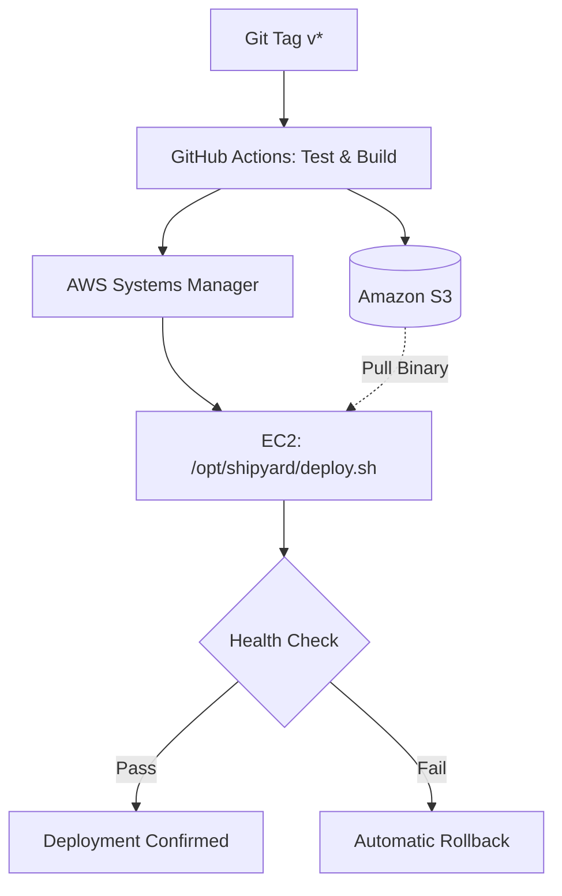
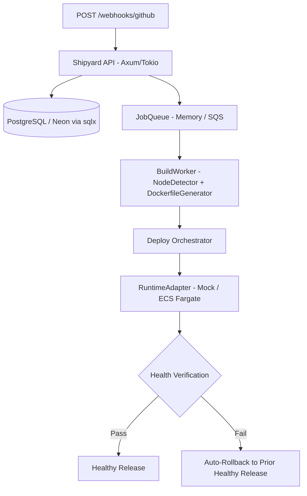

# Shipyard Cloud

A Rust-powered cloud-native deployment control plane for Node.js web services and APIs, providing reproducible releases, GitHub push-to-deploy webhooks, PostgreSQL persistence, health-gated rollouts, and verified host deployments on AWS infrastructure.

For the full product and architectural specification, see [PRD.md](PRD.md).

---

## Architecture

Shipyard separates control plane self-deployment (GitHub Actions -> S3 -> AWS SSM -> EC2) from managed application deployments (GitHub Webhook -> Rust Control Plane -> Build Worker -> Runtime Adapter).



### Managed Application Pipeline



---

## Technology Stack

| Component | Technology | Role |
| :--- | :--- | :--- |
| **Control Plane API** | Rust, Axum, Tokio | Asynchronous HTTP API, state machines, and webhook signature verification |
| **Persistence** | PostgreSQL (Neon), SQLx | Connection-pooled storage (`PgProjectStore`) and embedded schema migrations |
| **Build Engine** | Rust (`NodeDetector`, `DockerfileGenerator`) | Package manager detection (`npm`, `pnpm`, `yarn`) and hardened multi-stage Dockerfiles |
| **CI/CD** | GitHub Actions | Automated formatting, testing (`cargo test --locked`), and release packaging |
| **Compute** | AWS EC2 (Ubuntu 24.04) | Hosts `shipyard.service` supervised by systemd behind Caddy HTTPS |
| **Artifacts** | Amazon S3 | Private bucket (`shipyard-artifacts-123`) storing release binaries by commit SHA |
| **Deployment** | AWS Systems Manager (SSM) | Outbound HTTPS command execution (`/opt/shipyard/deploy.sh`) with local rollback |

---

## API Reference

| Method | Path | Description |
| :--- | :--- | :--- |
| `GET` | `/health` | Control plane health probe (`{"status":"ok","service":"shipyard-api"}`) |
| `POST` | `/projects` | Register a project (`name`, `repo_url`, optional `default_branch`) |
| `GET` | `/projects` | List registered projects ordered by creation timestamp |
| `GET` | `/projects/{id}` | Retrieve a single project by UUID |
| `GET` | `/projects/{id}/builds` | List builds for a project |
| `GET` | `/builds/{id}` | Retrieve a build record and image digest (`sha256:...`) |
| `POST` | `/deployments` | Trigger a deployment (`project_id`, `commit_sha`, optional `target_type`) |
| `GET` | `/deployments/{id}` | Retrieve deployment state and diagnostic `failure_reason` |
| `GET` | `/projects/{id}/deployments` | List deployment history for a project |
| `POST` | `/deployments/{id}/rollback` | Trigger rollback for a `failed` deployment (`Failed -> RollingBack -> RolledBack`) |
| `POST` | `/webhooks/github` | Verify `X-Hub-Signature-256`, deduplicate via `X-GitHub-Delivery`, and enqueue builds |

---

## Local Development

### Prerequisites

- Rust toolchain (stable, 2024 edition)
- Cargo
- Optional: PostgreSQL / Neon connection string in `.env` (falls back to `MemoryProjectStore` if `DATABASE_URL` is unset)

### Environment Variables

Copy `.env.example` to `.env`:

```env
DATABASE_URL=postgresql://<user>:<password>@<host>/<db>?sslmode=require
GITHUB_WEBHOOK_SECRET=<your-webhook-secret>
```

When `DATABASE_URL` is set, `shipyard-api` automatically runs embedded migrations from `apps/api/migrations/` on startup and persists all projects, builds, deployments, and processed webhook delivery IDs in PostgreSQL.

### Commands

```bash
# Check code formatting
cargo fmt --all -- --check

# Format codebase automatically
cargo fmt --all

# Run Clippy lints
cargo clippy --workspace --all-targets -- -D warnings

# Run all unit, route, build-engine, and PostgreSQL integration tests
cargo test --workspace --locked

# Start control plane locally (http://127.0.0.1:3000)
cargo run

# Build optimized release binary
cargo build --release --locked
```

---

## Release Procedure

To trigger an automated deployment to EC2 via `.github/workflows/release.yml`:

```bash
git tag v0.1.5
git push origin v0.1.5
```

GitHub Actions executes CI, uploads the Linux release binary to S3, and runs `/opt/shipyard/deploy.sh` via AWS SSM with health verification and automatic local rollback.

---

## Roadmap

| Milestone | Scope | Status |
| :--- | :--- | :--- |
| **Milestone 1** | Infrastructure & CI/CD Foundation (Rust API, GitHub Actions CI/Release, S3 artifacts, SSM EC2 deploy) | Completed |
| **Milestone 2** | Control Plane Domain & Build Engine (Projects/Builds/Deployments REST API, GitHub webhooks, `NodeDetector`, `DockerfileGenerator`, `BuildWorker`, auto-rollback) | Completed |
| **Milestone 3** | PostgreSQL Persistence & Database Migrations (`sqlx::migrate!`, `PgProjectStore` on Neon, restart durability, overlapping-deployment guard) | Completed |
| **Milestone 4** | AWS ECS/Fargate & SQS Integration (`SqsJobQueue`, `EcsRuntimeAdapter`, ECR digest publishing, `infra/` definitions) | Next |
| **Milestone 5** | Dashboard & Observability (`apps/web/` React + TypeScript + Vite UI, CloudWatch log aggregation) | Planned |
