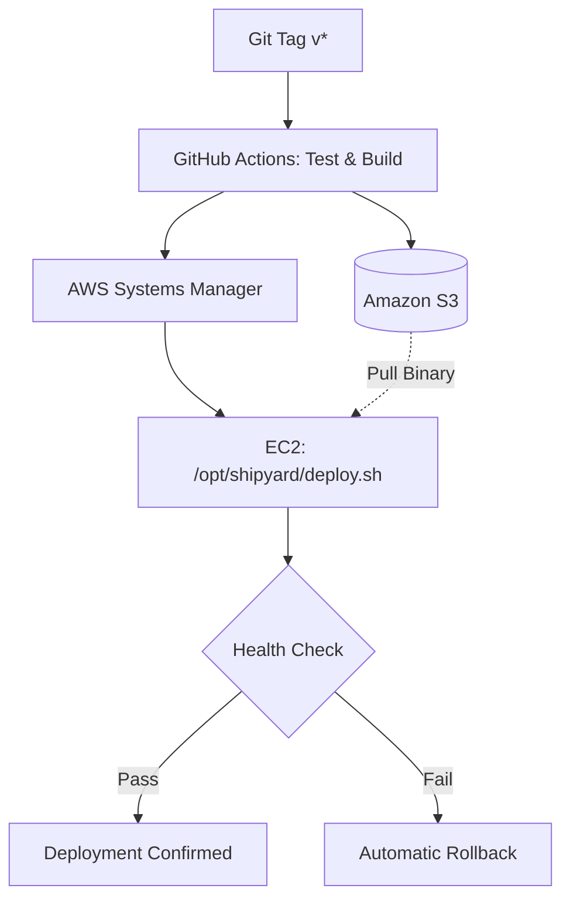
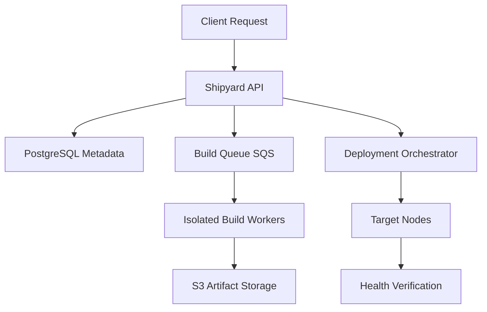

# Shipyard

A Rust-powered deployment system providing reproducible releases, automated delivery, and verified host deployments on AWS infrastructure.

---

## Architecture

Shipyard automates code delivery from a Git commit to an EC2 host via AWS Systems Manager (SSM), eliminating the need for inbound SSH access.




### Target Platform Architecture



---

## Technology Stack

| Component | Technology | Role |
| :--- | :--- | :--- |
| **API** | Rust, Axum, Tokio | Asynchronous HTTP service with zero-allocation serialization |
| **CI/CD** | GitHub Actions | Reusable pipelines for formatting, testing, and release packaging |
| **Compute** | AWS EC2 (Ubuntu 24.04) | Hosts application binary supervised by systemd |
| **Artifacts** | Amazon S3 | Private bucket storing immutable binaries keyed by commit SHA |
| **Deployment** | AWS Systems Manager (SSM) | Outbound HTTPS command execution (replaces inbound SSH) |
| **Host Automation** | Bash (`/opt/shipyard/deploy.sh`) | Binary validation, backup swap, service restart, and rollback |

---

## API Reference

### Health Probe

Probes service availability. Bound to `127.0.0.1:3000` (loopback only).

- **Method**: `GET /health`
- **Response**: `200 OK`

```json
{
  "status": "ok",
  "service": "shipyard-api"
}
```

---

## Deployment & Verification Flow

1. **Build & Package**: A version tag (`v*`) triggers `.github/workflows/release.yml`, executing formatting checks (`cargo fmt --check`), test suites (`cargo test --locked`), and release compilation (`cargo build --release --locked`).
2. **Artifact Publishing**: The validated binary is uploaded to `s3://shipyard-artifacts-123/releases/<SHA>/shipyard-api`.
3. **SSM Execution**: GitHub Actions invokes `/opt/shipyard/deploy.sh <SHA>` on the EC2 target via SSM Run Command (`AWS-RunShellScript`).
4. **Host Lifecycle**:
   - Downloads release binary from S3 using the EC2 instance's IAM role.
   - Validates ELF executable headers.
   - Backs up active binary to `shipyard-api.prev`.
   - Restarts `shipyard.service` via systemd.
   - Probes `http://127.0.0.1:3000/health`.
   - Automatically restores `shipyard-api.prev` and exits with an error code if the health check fails.

---

## Local Development

### Prerequisites

- Rust toolchain (stable, 2024 edition)
- Cargo

### Commands

```bash
# Check code formatting
cargo fmt --check

# Format codebase automatically
cargo fmt

# Run tests
cargo test --locked

# Start service locally (http://127.0.0.1:3000)
cargo run

# Build optimized release binary
cargo build --release --locked
```

---

## Release Procedure

To trigger an automated deployment to infrastructure:

```bash
git tag -a v0.1.0 -m "Release v0.1.0"
git push origin v0.1.0
```

GitHub Actions will execute the release workflow, stream execution status, and verify deployment via SSM.

---

## Roadmap

| Phase | Milestone | Status |
| :--- | :--- | :--- |
| **Phase 1** | Single-node pipeline: Rust API, CI, S3 artifacts, systemd, SSM deployment, automated rollback | Implemented (SSM validation in progress) |
| **Phase 2** | Deployment Management API: CRUD endpoints for deployment tracking, structured tracing | Planned |
| **Phase 3** | Asynchronous Build Queue: SQS-backed job distribution and isolated build sandboxes | Planned |
| **Phase 4** | Persistent State & Observability: PostgreSQL metadata storage, deployment history | Planned |
| **Phase 5** | Multi-Target Rollouts: Blue/green deployments, canary groups, deployment locking | Planned |
